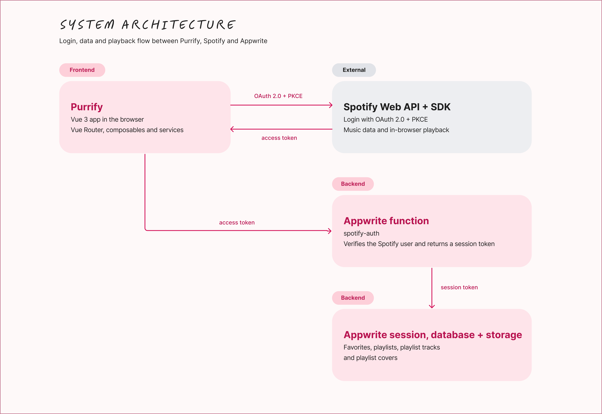
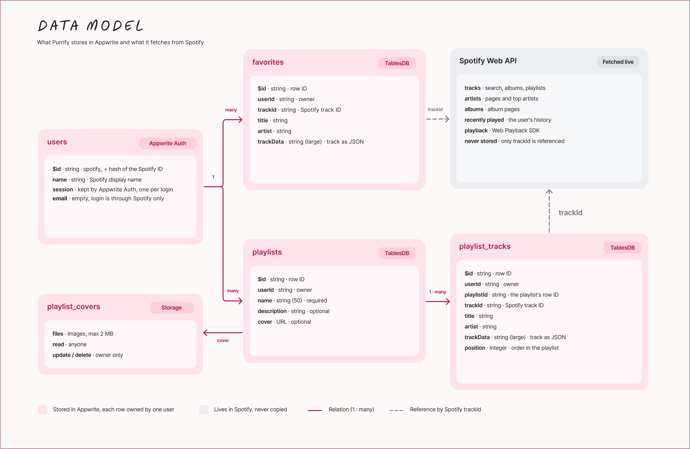

# 🎧 Purrify — Music Streaming Web App

Purrify is a responsive music streaming web app built with Vue 3, TypeScript and Tailwind CSS. I created it as my exam project for the Advanced JavaScript course, in the 3rd semester of the Multimedia Design programme. Purrify connects to your Spotify account, so you can discover music, play songs right in your browser, save your favorites and create your own playlists, all in a cozy, cat-themed interface.

The application uses Appwrite for user authentication integration and database storage, allowing users to keep their favorite songs and custom playlists across sessions.

**Live app:** [purrify-app.appwrite.network](https://purrify-app.appwrite.network/)

**Repository:** https://github.com/Patricia-P-G/Purrify-App


## Table of contents

1. [Features](#features)
2. [Tech stack](#tech-stack)
3. [System architecture](#system-architecture)
4. [Users, authentication and permissions](#users-authentication-and-permissions)
5. [Data model](#data-model)
6. [Project structure](#project-structure)
7. [Code organisation and design patterns](#code-organisation-and-design-patterns)
8. [Getting started](#getting-started)
9. [Appwrite setup](#appwrite-setup)
10. [Deployment](#deployment)
11. [Accessibility and SEO](#accessibility-and-seo)
12. [AI-assisted development](#ai-assisted-development)
13. [Known limitations](#known-limitations)
14. [What I learned](#what-i-learned)
15. [Credits](#credits)


## Features

### 🏠 Home

- A hero carousel with three mood playlists (Focus, Chill Afternoon, Night Vibes) that start playing with one click.
- **Recently played**, **Made for you**, **Recommended for you** and **Top artists** sections, all based on your Spotify listening data.
- Recommendations refresh every three hours and avoid repeating songs you have already been shown.

### 🔍 Search and discovery

- Live search with a dropdown preview (top artist and top songs) that updates as you type.
- A full search results page for songs, albums and artists.
- A Discover page with 12 genres, each opening a page of matching Spotify playlists.
- Artist pages (popular songs and albums) and album pages.

### ▶️ Music player

- Full in-browser playback through the Spotify Web Playback SDK.
- Play/pause, next/previous, a clickable and keyboard-controllable progress bar, volume and mute.
- Automatically plays the next song in the queue when a track ends.
- A desktop player bar, a mobile mini player and a full-screen "Now playing" view on mobile.

### ❤️ Favorites and playlists (full CRUD)

- Add and remove favorite songs from anywhere in the app.
- **Create** playlists with a name, description and an optional cover image.
- **Read** your playlists, plus open public Spotify playlists from the genre pages.
- **Update** a playlist's name, description and cover.
- **Delete** playlists, and add or remove individual songs.
- Everything is saved in Appwrite, so it persists across refreshes and devices.
- The interface updates instantly (optimistic updates) and rolls back if saving fails.

### ✨ User experience

- Responsive layout with a sidebar on desktop and bottom navigation on mobile.
- Toast notifications for favorite and playlist actions.
- Infinite scrolling and per-page search on long song lists.
- Loading skeletons, error states with "Try again" and empty states.

## Tech stack

| Technology | Used for |
|---|---|
| [Vue 3](https://vuejs.org/) (Composition API, `<script setup>`) | Component-based UI |
| [TypeScript](https://www.typescriptlang.org/) | Type safety across components, composables and services |
| [Vite](https://vite.dev/) | Dev server and production build |
| [Tailwind CSS v4](https://tailwindcss.com/) | Styling, design tokens and reusable component classes |
| [Vue Router](https://router.vuejs.org/) | Client-side routing and the auth route guard |
| [Spotify Web API](https://developer.spotify.com/documentation/web-api) | Songs, albums, artists, playlists and listening history |
| [Spotify Web Playback SDK](https://developer.spotify.com/documentation/web-playback-sdk) | Playing music in the browser |
| [Appwrite](https://appwrite.io/) | User sessions, database (TablesDB), file storage and a serverless function |
| [Swiper](https://swiperjs.com/) | Hero carousel |
| [Unhead](https://unhead.unjs.io/) | Page titles and meta descriptions |


## System architecture



1. **Login.** The user clicks *Connect with Spotify* and is sent to Spotify's own login page. This uses **OAuth 2.0**, the standard way to let one app access your account on another service without ever seeing your password. The user logs in on Spotify and agrees to what Purrify may access (the "scopes"). Spotify then sends Purrify back a temporary **access token** instead of a password. Purrify uses the **Authorization Code flow with PKCE**, a version of OAuth made for apps that run in the browser: it proves the login request came from Purrify without needing a client secret, so no secret is stored in the frontend.
2. **Callback.** `/callback` exchanges the code for an access token and a refresh token. Tokens refresh automatically before they expire, and also whenever Spotify returns `401`.
3. **Appwrite session.** The Spotify access token is sent to an Appwrite function (`spotify-auth`), which verifies it and returns a one-time token. That token is used to create an Appwrite session for the same user.
4. **Data.** Music data comes straight from Spotify. User-created data (favorites, playlists and covers) is stored in Appwrite with row-level permissions, so each user can only read and change their own rows.
5. **Playback.** The Web Playback SDK registers Purrify as a Spotify device, and songs are played on that device.

### Code layers

The code is organized in layers, so the components stay small and the logic can be reused:

- **Services** (`src/services/`) are the only place that talks to Spotify or Appwrite.
- **Composables** (`src/composables/`) hold shared state and logic such as the player queue, favorites, playlists, track lists, infinite scroll and toasts.
- **Features** (`src/features/`) are the pages, grouped by feature.
- **Components** (`src/components/`) are reusable UI building blocks used across features.


## Users, authentication and permissions

### Areas of the app

| Area | Who can access it | What they can do |
|---|---|---|
| Public: `/` (login page) and `/callback` | Everyone | See what Purrify is and connect with Spotify |
| User area: all other routes | Logged-in users | Browse, search and play music |
| Library management: Playlists and Favorites | Logged-in users, only for their own data | Create, edit and delete playlists, upload covers, and manage songs and favorites |

### Security is enforced in the backend, not only in the UI

Hiding a button does not protect anything, so Purrify protects data on three levels:

1. **Navigation guard.** Routes with `meta.requiresAuth` check the Appwrite session with `account.get()` before they load. Without a valid session, the user is redirected to the login page. A network error keeps the user on the current page instead of logging them out.
2. **Row-level permissions.** Every row is created with `read`, `update` and `delete` permissions for its owner only. Even if someone calls the Appwrite API directly with another user's row ID, Appwrite rejects the request.
3. **Ownership check.** Before a song is added to a playlist, the service checks that the playlist belongs to the current user. Queries are also always filtered by `userId`.

Playlist cover images are readable by anyone, so they can be displayed as plain image URLs, but only the owner can replace or delete them.

### Session flow

- Spotify tokens are saved in `localStorage` and refreshed automatically. When several requests hit an expired token at the same time, only one refresh request is made.
- If a different Spotify user logs in on the same browser, the previous Appwrite session is deleted first.
- Logging out clears the Appwrite session, the Spotify tokens and all cached favorites and playlists in memory.


## Data model



- **Why are songs stored in separate tables?** A playlist can contain many songs. Storing them as separate rows makes adding or removing one song a small operation, instead of rewriting the whole playlist. The `position` column keeps the order.
- **Why save a copy of each track (`trackData`)?** Lists can render straight from Appwrite without one Spotify request per song. If a saved copy is missing or incomplete, the app fetches the track from Spotify again and repairs the row.
- **What stays in Spotify?** Music catalog data (artists, albums, search and listening history) is fetched live from Spotify and is never copied into the database.


## Project structure

The folder structure is **hybrid**. Pages are grouped **by feature** in `features/` (everything for favorites lives in `features/favorites/`), while code shared across features is grouped **by type** (`components/`, `composables/`, `services/`, `utils/`, `types/`). This keeps each page's files together, without duplicating shared code in every feature folder.

```text
docs/
└── system-architecture.png  # Diagram used in this README
functions/
└── spotify-auth/      # Appwrite function that links Spotify users to Appwrite
src/
├── assets/            # Fonts, icons and images
├── components/
│   ├── layout/        # AsideNav, NavBar, ProfileDropdown
│   ├── music/         # TrackList, AlbumSection, PlayButton, MusicPlayer, …
│   │   └── player/    # DesktopPlayer, MiniPlayer, FullPlayer and their shared parts
│   └── ui/            # ActionToast, SearchBar, ErrorState, LoadMoreTrigger, …
├── composables/       # usePlayer, useFavorites, usePlaylists, useTrackListView, …
├── features/
│   ├── auth/          # LoginView, CallbackView
│   ├── catalog/       # AlbumView, ArtistView
│   ├── discover/      # DiscoverView, GenreView
│   ├── favorites/     # FavoritesView
│   ├── home/          # HomeView and its sections
│   ├── playlists/     # PlaylistsView, SinglePlaylistView and the playlist modals
│   ├── recently-played/
│   └── search/        # SearchView, SearchDropdown
├── router/            # Routes and the authentication guard
├── services/
│   ├── appwrite/      # Client, auth, session, favorites, playlists, storage
│   └── spotify/       # Auth (PKCE), API client, player SDK wrapper, mappers
├── styles/            # Tailwind theme and shared component classes
├── types/             # Shared TypeScript types
├── utils/             # Formatting and favorite-track helpers
├── App.vue
└── main.ts
```

## Code organisation and design patterns

### Single Responsibility Principle (SRP)

Each file has one job. Some examples:

| File | Does | Doesn't do |
|---|---|---|
| `composables/usePlayerVolume.ts` | Keeps the volume and mute state and sends it to Spotify | Anything about the current song or progress |
| `composables/usePlayerProgress.ts` | Calculates the progress bar and seeks inside the song | Volume, or choosing the next song |
| `services/spotify/api/spotifyClient.ts` | Sends requests to Spotify, adds the access token, refreshes it on a `401` and pauses requests while Spotify is rate-limiting | Knowing what the data means or how it's displayed |
| `services/spotify/spotifyTrackMapper.ts` | Turns Spotify's raw track data into Purrify's own `Track` type | Fetching anything |
| `services/appwrite/storage.ts` | Uploads, replaces and deletes playlist covers | Saving the playlist itself |
| `utils/format.ts` | Formats durations (`3:45`, and "3 minutes 45 seconds" for screen readers) | Anything with state |

### Separation of Concerns (SoC)

The app is split into layers, and each layer only talks to the one below it:

```text
View / component  →  composable          →  service                 →  Spotify or Appwrite
(what you see)       (logic and state)      (talks to the API)
```

For example, clicking the heart button in the player goes through these layers:

1. `PlayerFavoriteButton.vue` shows the heart and reacts to the click. It doesn't save anything itself.
2. `useFavoriteActions` toggles the favorite and shows a toast message.
3. `useFavorites` blocks double clicks, updates the list immediately (optimistic update) and undoes the change if saving fails.
4. `services/appwrite/favorites.ts` sends the request to Appwrite.

Because of this, the Appwrite code could be replaced without changing any component, and components never contain API calls.

### Smart and dumb components

- **Smart components** (the views in `features/`) know *where data comes from*. `FavoritesView.vue` loads favorites with `useFavorites()`, connects playback with `useTrackListView()` and sets the page title with `useHead()`.
- **Dumb components** only know *how to show data*. They get everything through **props** and report actions with **emits**.
  - `TrackList.vue` receives `tracks`, `isPlaying`, `currentTrackId` and `isFavorite`, and emits `trackClick`, `favoriteClick` and `menuClick`. It doesn't fetch songs, play music or save favorites.
  - `PlayButton.vue` only receives `active`, `playing` and `size` and draws the right icon.

**Why do it this way?**

- **Reusability.** The same `TrackList` is used for favorites, albums, playlists and recently played songs, because it doesn't care where the songs come from.
- **Easier to change.** The track list's look is changed in one place, and the logic is changed in another.
- **Easier to understand and test.** A dumb component behaves the same way for the same props.

Small exceptions are deliberate. `PlayerFavoriteButton` connects to `useFavoriteActions` directly, because it's used in all three player layouts, and passing the same props through each of them would only add code.

### Destructuring and imports

- **Destructuring** takes only what a component needs from a composable:

  ```ts
  const { favoriteTracks, loadFavorites, isLoading } = useFavorites();
  ```

- **The `@/` alias** points to `src/`, so imports stay readable from any folder: `import TrackList from "@/components/music/TrackList.vue"` instead of `../../components/...`.
- **`import type`** is used for TypeScript types only (`import type { Track } from "@/types/music"`). These imports are removed in the build, so they add nothing to the bundle.
- **Lazy loading.** Every route is imported with `() => import(...)`, and the playlist modals are loaded with `defineAsyncComponent`. Their code is only downloaded when the page or modal is opened.

### Reusability and maintainability

- **Shared components** such as `TrackList`, `MusicHeroLayout`, `SearchBar`, `ErrorState`, `LoadMoreTrigger` and `ScreenReaderStatus` are reused on many pages instead of copying markup.
- **Shared composables** such as `useTrackListView`, `useInfiniteScroll` and `usePlaybackAction` hold logic that several pages need.
- **One data shape.** Spotify data is converted to the `Track` type once, in the mapper. The rest of the app never works with raw Spotify data, so a change in Spotify's API only needs a fix in one place.
- **TypeScript types** in `types/` describe the data, so mistakes are caught before the app runs.
- **Named constants** such as `MAX_COVER_SIZE` and the cache keys are defined once, instead of repeating the same values in several places.
- **Images:** photos and illustrations are in **WebP**, which is much smaller than PNG or JPG at the same quality. Icons are **SVG**, so they stay sharp at any size. PNG is only used for the favicon and app icons, because browsers and phones require that format.


## Getting started

### Prerequisites

- **Node.js** `^22.18.0` or `>=24.12.0`, and npm
- A **Spotify Premium** account. The Web Playback SDK only works with Premium.
- A **Spotify Developer** app ([dashboard](https://developer.spotify.com/dashboard))
- An **Appwrite** project ([Appwrite Cloud](https://cloud.appwrite.io/) or self-hosted)

### 1. Clone and install

```bash
git clone https://github.com/Patricia-P-G/Purrify-App.git
cd Purrify-App
npm install
```

### 2. Set up the Spotify app

1. Create an app in the Spotify Developer Dashboard and enable **Web API** and **Web Playback SDK**.
2. Add a redirect URI, for example `http://127.0.0.1:5173/callback`. Spotify no longer accepts `localhost`, so use `127.0.0.1`.
3. While the app is in **Development mode**, add every test user's Spotify email under **User Management**.

The app requests these scopes:

```text
user-read-private user-read-email user-read-recently-played user-top-read
streaming user-read-playback-state user-modify-playback-state
```

### 3. Environment variables

Create a `.env` file in the project root. It is already ignored by git.

```env
# Spotify
VITE_SPOTIFY_CLIENT_ID=your_spotify_client_id
VITE_SPOTIFY_REDIRECT_URI=http://127.0.0.1:5173/callback

# Appwrite
VITE_APPWRITE_ENDPOINT=https://cloud.appwrite.io/v1
VITE_APPWRITE_PROJECT_ID=your_project_id
VITE_APPWRITE_DATABASE_ID=your_database_id
VITE_APPWRITE_FAVORITES_TABLE_ID=favorites
VITE_APPWRITE_PLAYLISTS_TABLE_ID=playlists
VITE_APPWRITE_PLAYLIST_TRACKS_TABLE_ID=playlist_tracks
VITE_APPWRITE_COVERS_BUCKET_ID=playlist_covers
```

### 4. Run

```bash
npm run dev          # start the dev server
npm run build        # type-check and build for production
npm run preview      # preview the production build
```

Open the URL Vite prints, using the same host as your redirect URI (for example `http://127.0.0.1:5173`).


## Appwrite setup

### Database tables

Enable **row security** on every table, and give the `Users` role permission to create rows. The app sets read, update and delete permissions on each row for its owner.

**`favorites`**

| Column | Type | Notes |
|---|---|---|
| `userId` | string | Owner |
| `trackId` | string | Spotify track ID |
| `title` | string | |
| `artist` | string | |
| `trackData` | string (large) | The full track saved as JSON |

**`playlists`**

| Column | Type | Notes |
|---|---|---|
| `userId` | string | Owner |
| `name` | string (50) | Required |
| `description` | string | Optional |
| `cover` | string (URL) | Optional, links to the storage bucket |

**`playlist_tracks`**

| Column | Type | Notes |
|---|---|---|
| `userId` | string | Owner |
| `playlistId` | string | Row ID of the playlist |
| `trackId` | string | Spotify track ID |
| `title` | string | |
| `artist` | string | |
| `trackData` | string (large) | The full track saved as JSON |
| `position` | integer | Order of the song in the playlist |

Add indexes on `userId`, `trackId`, `playlistId` and `position`, because the queries filter and sort by these columns.

### Storage

Create a bucket (for example `playlist_covers`) for playlist cover images. Limit it to image file types and a maximum file size of **2 MB**. This matches the app's own check, which rejects larger covers before uploading.

### Function

Create a function with the ID **`spotify-auth`**. It should:

1. Receive `{ accessToken }` in the request body.
2. Call `https://api.spotify.com/v1/me` with that token to verify the user.
3. Find or create an Appwrite user for that Spotify account.
4. Create a token with `users.createToken(userId)` and return `{ userId, secret }`.

The function source code is in [`functions/spotify-auth/`](functions/spotify-auth/). I created the function in the Appwrite console and imported the code manually as a deployment (a `.tar.gz` archive of the folder), instead of connecting it to Git or using the Appwrite CLI. When the code changes, a new archive has to be uploaded manually.


## Deployment

The live link and the repository link are at the top of this README.

The app is hosted on **Appwrite Sites** as a static Vite build:

- Build command: `npm run build`
- Output directory: `dist`
- Single-page app fallback: rewrite all routes to `index.html`, so routes like `/playlists/123` work when the page is refreshed.
- Set every `VITE_*` environment variable in the hosting dashboard. The `.env` file is not committed.
- Add the live URL in two places: as a **redirect URI** in the Spotify dashboard (`https://your-app.../callback`), and as a **Web platform** in Appwrite.

> **For examiners.** The Spotify app runs in development mode, so Spotify only allows accounts that have been added in the dashboard. Contact me with the email associated with your Spotify account to request access. Playback requires Spotify Premium; without it, music playback will not work.

No secrets are committed to the repository. `VITE_*` values such as the Spotify client ID and the Appwrite project ID are public identifiers by design. The PKCE flow means no Spotify client secret is needed in the frontend.


## Accessibility and SEO

- Semantic HTML landmarks (`main`, `nav`, `aside`, `header`, `section`) and a clear heading structure.
- ARIA labels, `aria-pressed`, `aria-expanded`, `aria-current` and `role="dialog"` on interactive elements.
- Screen-reader announcements for search results, loading states and playback errors.
- Visible keyboard focus styles on all interactive elements, and keyboard seeking on the progress bar (← / →).
- `prefers-reduced-motion` support, which turns off autoplay and animations.
- Unique page titles and meta descriptions on every route (Unhead).
- Lazy-loaded images with explicit sizes, a preloaded hero image and a self-hosted font with `font-display: swap`.


## AI-assisted development

### Tools used

| Tool | Model | Used for |
|---|---|---|
| Claude (claude.ai) | Claude Opus 5.5 | Code review, checking the project against the brief, refactoring, writing documentation |
| ChatGPT | GPT-6 | Debugging Vue and TypeScript, refactoring components, improving responsive layouts and accessibility, troubleshooting Spotify playback and Appwrite integration |

### What I mainly used AI for

- **Code review.** I asked Claude to find duplicated and unnecessary code and rate the project. It identified repeated markup across pages, unused assets (about 1.5 MB) and several small bugs. I also used ChatGPT to review individual Vue components, check their logic and identify possible improvements.
- **Refactoring.** Claude helped me plan the separation of the 447-line `MusicPlayer.vue` into smaller components and composables. I also used ChatGPT to improve individual components, simplify repeated logic and keep their functionality reusable.
- **Debugging.** I used ChatGPT to investigate problems with infinite scrolling, track playback, favorite actions, Spotify authentication, Appwrite integration and Vue console warnings.
- **Responsive design.** ChatGPT helped me improve mobile layouts, particularly the Recommended for You section, mobile track interactions and playlist options menus.
- **Accessibility.** I used ChatGPT to review ARIA attributes, keyboard interactions, semantic HTML and color contrast issues identified by Lighthouse.
- **Documentation.** I used Claude and ChatGPT to structure this README, explain technical decisions and describe the project's architecture and implementation.

### Examples: where AI helped

**Claude — Code review and refactoring**

The code review found that the toast notification was rendered both inside `TrackList` and on every page. Because the toast state is shared, two identical toasts appeared on top of each other, and screen readers announced every message twice. I moved one `<ActionToast>` into `App.vue` and removed the duplicate copies.

The same review led me to extract `LoadMoreTrigger`, `ScreenReaderStatus` and `usePlaybackAction`, which removed repeated code from several pages. It also found that the recommendation caches were not cleared on logout, so a second user on the same browser could see the first user's recommendations.

**ChatGPT — Infinite scrolling**

I used ChatGPT to troubleshoot an issue where the infinite scrolling trigger was not activating correctly. We reviewed the interaction between `useInfiniteScroll` and `LoadMoreTrigger`, simplified the trigger handling and adjusted the loading behavior.

This helped me understand how the Intersection Observer works and how a reusable composable can handle loading additional content across different pages.

**ChatGPT — Mobile playback and responsive design**

I used ChatGPT to improve `TrackList.vue` so that users could tap album covers and song titles to play or pause music on mobile.

I also improved the Recommended for You section by increasing the album cover size and song title text on smaller screens while preserving the existing favorite buttons, playlist actions and desktop layout.

Another issue involved the playlist options dropdown, which extended beyond the screen on mobile. ChatGPT helped me identify the positioning issue and fix it by aligning the dropdown to the right of its trigger.

**ChatGPT — Accessibility improvements**

I used ChatGPT to review accessibility issues, including insufficient color contrast on the Spotify login button. I adjusted the button colors to improve readability.

I also used it to review ARIA attributes, screen-reader feedback and keyboard interactions in reusable components.

**ChatGPT — Spotify and Appwrite troubleshooting**

I used ChatGPT to investigate Spotify playback errors when testing the application with different Premium accounts. It helped me understand possible causes related to authentication, access tokens, player initialization and device availability.

I also used ChatGPT to understand Appwrite session warnings and Vue console messages, helping me distinguish between actual errors and informational warnings.

### Examples: where I adjusted or corrected AI

- **Corrected: the Appwrite function.** Claude couldn't see the function I had deployed in Appwrite, so it wrote a version based on how my frontend calls it. When I compared it with my real function, they worked differently. Claude's version looked users up by email, but mine creates the Appwrite user ID from a hash of the Spotify ID. Using Claude's version would have created new accounts for every existing user, and their favorites and playlists would have disappeared. I committed my own deployed function instead.
- **Adjusted: mobile layout suggestions.** When I asked ChatGPT to improve the Recommended for You section, some suggestions changed more of the layout than I wanted. I clarified that I only needed larger album covers and song titles on mobile, without changing the existing actions or adding unnecessary spacing.
- **Adjusted: component functionality.** When working with ChatGPT on reusable components, I made sure the proposed changes preserved existing behavior instead of replacing working functionality with a different implementation.

### Reflection

AI was useful throughout the development process, particularly for reviewing code, identifying bugs, improving component structure and solving implementation problems.

Claude was especially helpful for reviewing the overall codebase and identifying duplicated code. ChatGPT was more useful when I needed help with specific issues, such as debugging Vue components, improving mobile responsiveness, reviewing accessibility and troubleshooting Spotify and Appwrite integration.

However, human judgement was still necessary. I decided which suggestions fit the scope of my project and rejected those that introduced unnecessary complexity. I also corrected AI-generated solutions when they did not match my existing implementation or requirements.

I tested the changes in the browser and adjusted the code based on the actual results. This helped me understand the importance of providing clear context, evaluating AI suggestions critically and not relying on generated code without reviewing it.


## Known limitations

- **Spotify Premium is required** for playback. This is a restriction of the Web Playback SDK.
- **Development mode quota.** Spotify apps in development mode only work for users added in the dashboard, and they have stricter rate limits.
- Spotify no longer gives new apps access to some endpoints (such as recommendations and the full contents of some editorial playlists). Purrify works around this by building recommendations from your top artists and search results, and it shows a message when a playlist's songs can't be accessed.
- Playback works on desktop browsers. Mobile browsers have limited support for the Web Playback SDK.


## What I learned

- Structuring a larger Vue 3 application into services, composables and features.
- Implementing OAuth 2.0 with PKCE, including token refresh and handling rate limits.
- Managing shared state (player queue, favorites, playlists) with composables instead of a store library.
- Building full CRUD with Appwrite, including row-level permissions, file uploads and rollback when a save fails.
- Handling asynchronous edge cases such as outdated requests, duplicate clicks and switching between users.
- Designing a responsive, accessible interface with Tailwind CSS.


## Credits

- Music data and playback by [Spotify](https://developer.spotify.com/). Purrify is an independent educational project and is **not affiliated with or endorsed by Spotify**.
- Backend by [Appwrite](https://appwrite.io/).
- Font: [Fredoka](https://fonts.google.com/specimen/Fredoka) (SIL Open Font License).
- Icons: [Iconify](https://iconify.design/)
- Illustrations: my own sketches, turned into the final illustrations with the help of AI
